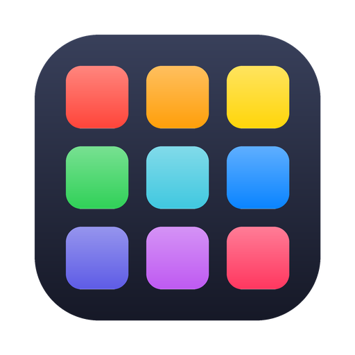

<p align="center">
  
</p>

<h1 align="center">Launchpad Classic</h1>

<p align="center">
  <strong>Twój stary Launchpad wraca na macOS 26 Tahoe.</strong><br>
  Siatka ikon, foldery, przeciąganie i strony, dokładnie tak jak przed aktualizacją. Tylko lepiej.
</p>

<p align="center">
  <a href="https://github.com/Calizhex/LaunchpadClassic/releases/latest"></a>
  
  
  
</p>

<!-- SCREENSHOT:hero -->

---

## Dlaczego Launchpad Classic?

W macOS 26 Tahoe Apple usunął Launchpada i zastąpił go widokiem „Aplikacje”. Ten widok sam układa ikony w kategorie, nie pozwala tworzyć własnych folderów i nie zapamiętuje układu, który budowałeś latami.

**Launchpad Classic przywraca to, co działało**, i dokłada rzeczy, których oryginał nigdy nie miał:

| | Systemowe „Aplikacje” (Tahoe) | **Launchpad Classic** |
|---|:---:|:---:|
| Własny układ ikon | ✗ | **✓** |
| Własne foldery z nazwami | ✗ | **✓** |
| Strony przewijane gestem | ✗ | **✓** |
| Import starego układu z Launchpada | ✗ | **✓** |
| Wielkość ikon i podpisów do ustawienia | ✗ | **✓** |
| Własna liczba kolumn i wierszy | ✗ | **✓** |
| Skrót klawiszowy i gorący narożnik | częściowo | **✓** |
| Automatyczne aktualizacje | – | **✓** |

---

## ✨ Najmocniejsze strony

### 🎯 Wierny jak oryginał
Pełnoekranowa siatka na rozmytej tapecie, kropki stron na dole, płynne animacje otwierania i zamykania. Przewijasz strony dwoma palcami na gładziku (z efektem „gumy” na krańcach), kółkiem myszy albo **⌘← / ⌘→**. Zaczynasz pisać i od razu wyszukujesz.

### 🗂 Foldery i przeciąganie
Przytrzymaj ikonę albo po prostu ją złap. Ikony zaczynają się „trząść”, a reszta płynnie robi miejsce. Upuść jedną aplikację na drugą, a powstanie folder, który **sam dostaje nazwę z kategorii** (np. „Produktywność”, „Narzędzia dla programistów”). Przytrzymaj ikonę przy krawędzi ekranu, żeby przenieść ją na sąsiednią stronę.

<!-- SCREENSHOT:folder -->

### 🎨 Wygląd po Twojemu
Okno ustawień z **podglądem na żywo**:
- **Wielkość ikon**: od 50 do 150%
- **Wielkość podpisów**: od 9 do 20 pt
- **Liczba ikon na stronie**: od 4 do 12 kolumn i od 3 do 8 wierszy

Masz duży monitor? Zmieść 80 aplikacji na jednej stronie. Wolisz duże ikony na MacBooku Air? Też się da.

<!-- SCREENSHOT:appearance -->

### 🔄 Aktualizuje się sam
Co 6 godzin sprawdza, czy jest nowa wersja, i daje znać **powiadomieniem**. Jedno kliknięcie w **„Pobierz i zainstaluj”**, a aplikacja sama się podmienia i uruchamia ponownie. Bez szukania plików, bez przeciągania do folderu Aplikacje i bez okien z ostrzeżeniami. Możesz też sprawdzić ręcznie przyciskiem **„Sprawdź teraz”**.

<!-- SCREENSHOT:updates -->

### ⌨️ Zawsze pod ręką
- **Ikona na pasku menu** z szybkim dostępem do Launchpada, ustawień i aktualizacji
- **Globalny skrót klawiszowy**, domyślnie **⌃⌘L**, do zmiany w ustawieniach
- **Gorący narożnik**: najedź myszą w wybrany róg ekranu
- **Ikona w Docku**, którą można też ukryć
- **Start przy logowaniu**

### 🧠 Pamięta Twój układ
Przy pierwszym uruchomieniu próbuje **zaimportować układ ze starego Launchpada**, jeśli baza przetrwała aktualizację. Nowe aplikacje same trafiają na koniec, a te usunięte w Finderze znikają. Przed każdym resetem układu robi się kopia zapasowa.

### 🪶 Lekki i prywatny
Natywny Swift i SwiftUI, bez Electrona. Czeka w tle na skrót klawiszowy i przez ten czas praktycznie nie zużywa zasobów. Nie zbiera żadnych danych. Jedyne połączenie z internetem to sprawdzenie, czy na GitHubie jest nowa wersja.

---

## 📥 Instalacja

### Sposób 1: jedna komenda (polecany)
Wklej w Terminalu:

```bash
curl -fsSL https://raw.githubusercontent.com/Calizhex/LaunchpadClassic/main/install.sh | bash
```

Skrypt pobiera najnowszą wersję, instaluje ją w folderze Aplikacje i uruchamia. macOS nie zadaje przy tym żadnych pytań.

### Sposób 2: plik .dmg
1. Pobierz **`LaunchpadClassic.dmg`** z [najnowszego wydania](https://github.com/Calizhex/LaunchpadClassic/releases/latest).
2. Otwórz go i przeciągnij **Launchpad Classic** do folderu **Applications**.
3. Przy pierwszym uruchomieniu macOS pokaże ostrzeżenie, bo aplikacja nie ma płatnego podpisu Apple. Kliknij **Gotowe**, a potem w **Ustawieniach systemowych → Prywatność i ochrona** wybierz **„Otwórz mimo to”**.

> Ostrzeżenie pojawia się tylko raz. Kolejne aktualizacje instalowane z poziomu aplikacji już o nic nie pytają.

### Po instalacji
Przeciągnij **Launchpad Classic** do Docka w miejsce systemowej ikony „Aplikacje”. Jeśli chcesz, wyłącz też systemowy gest szczypnięcia w **Ustawieniach systemowych → Gładzik → Więcej gestów**.

---

## ⌨️ Skróty

| Skrót | Działanie |
|---|---|
| **⌃⌘L** | Otwórz lub zamknij Launchpad (do zmiany w ustawieniach) |
| *pisanie* | Wyszukiwanie |
| **↑ ↓ ← →** | Wybór ikony |
| **Return** | Uruchom zaznaczoną aplikację |
| **⌘← / ⌘→** | Poprzednia / następna strona |
| **Esc** | Wyjdź z wyszukiwania, folderu lub trybu edycji, a na końcu zamknij |
| *przytrzymanie ikony* | Tryb edycji („trzęsące się” ikony) |
| *prawy klik na tle* | Szybkie ustawienia |

---

## ❓ Pytania

**Czy aplikacja coś zmienia w systemie?**
Nie. Nie modyfikuje plików systemowych ani Docka. Układ trzyma w `~/Library/Application Support/LaunchpadClassic`.

**Jak odinstalować?**
Przenieś `Launchpad Classic.app` do Kosza. Jeśli chcesz usunąć też zapisany układ, usuń folder `~/Library/Application Support/LaunchpadClassic`.

**Jak usunąć aplikację z Launchpada?**
Tak jak każdą aplikację na Macu: w Finderze. Launchpad Classic sam zauważy zmianę.

**Czy działa na Intelu?**
Wydania są budowane dla Apple Silicon (M1 i nowsze). Na Intelu możesz zbudować aplikację samodzielnie, instrukcja jest niżej.

---

## 🛠 Budowanie ze źródeł

Potrzebny jest Xcode albo Command Line Tools (`xcode-select --install`):

```bash
git clone https://github.com/Calizhex/LaunchpadClassic.git
cd LaunchpadClassic
./build.sh install
```

Każdy push do gałęzi `main` automatycznie buduje nowy `.dmg` w GitHub Actions i publikuje go w [Releases](https://github.com/Calizhex/LaunchpadClassic/releases).

---

<p align="center">
  <sub>Niezależny projekt, niezwiązany z Apple Inc. „Launchpad” i „macOS” są znakami towarowymi Apple Inc.</sub>
</p>
